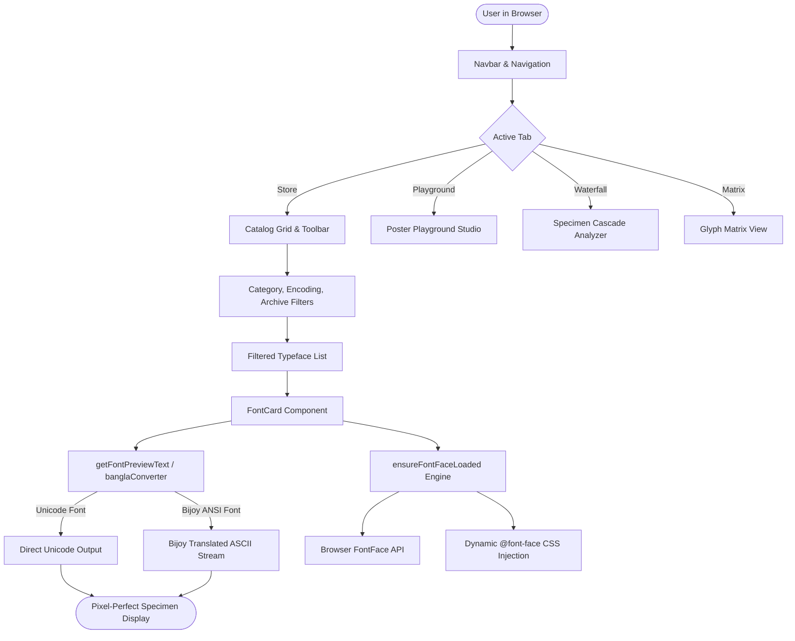

# AKSHAR (অক্ষর) — Knowledge Transfer & Engineering Architecture Document

> **Repository:** `Fontt-market`  
> **Application Name:** AKSHAR | অক্ষর — Modern Font Store & Typography Playground  
> **Last Updated:** October 2026  
> **Version:** 1.0.0  

---

## Table of Contents

1. [Executive Summary & Purpose](#1-executive-summary--purpose)
2. [Domain Knowledge: The Bengali Typography Landscape](#2-domain-knowledge-the-bengali-typography-landscape)
   - [2.1 Unicode vs. Bijoy (ANSI) Dual Ecosystem](#21-unicode-vs-bijoy-ansi-dual-ecosystem)
   - [2.2 The Anatomy of Bengali Letterforms & Glyphs](#22-the-anatomy-of-bengali-letterforms--glyphs)
   - [2.3 The "Broken Font" Problem & Why Fallbacks Fail](#23-the-broken-font-problem--why-fallbacks-fail)
3. [System Architecture & Tech Stack](#3-system-architecture--tech-stack)
   - [3.1 Technology Stack](#31-technology-stack)
   - [3.2 High-Level Architecture Diagram](#32-high-level-architecture-diagram)
   - [3.3 Directory & File Structure](#33-directory--file-structure)
4. [Font Engine & Webfont Subsystem](#4-font-engine--webfont-subsystem)
   - [4.1 Dual-Strategy Font Loading (`ensureFontFaceLoaded`)](#41-dual-strategy-font-loading-ensurefontfaceloaded)
   - [4.2 OpenType Sanitizer (OTS) & Chromium Compliance](#42-opentype-sanitizer-ots--chromium-compliance)
   - [4.3 Real-Time Unicode-to-Bijoy Transliteration Engine](#43-real-time-unicode-to-bijoy-transliteration-engine)
5. [Component Architecture & User Journeys](#5-component-architecture--user-journeys)
   - [5.1 Core State & Routing (`App.jsx`)](#51-core-state--routing-appjsx)
   - [5.2 Specimen Card (`FontCard.jsx`)](#52-specimen-card-fontcardjsx)
   - [5.3 Specimen Sheet Modal (`FontDetailModal.jsx`)](#53-specimen-sheet-modal-fontdetailmodaljsx)
   - [5.4 Poster Design Studio (`TypographyPlayground.jsx`)](#54-poster-design-studio-typographyplaygroundjsx)
   - [5.5 Analytical Specimen Waterfall (`WaterfallView.jsx`)](#55-analytical-specimen-waterfall-waterfallviewjsx)
   - [5.6 Side-by-Side Comparison (`ComparisonDrawer.jsx`)](#56-side-by-side-comparison-comparisondrawerjsx)
   - [5.7 E-Commerce Cart & Multi-Tier Licensing (`CartDrawer.jsx`)](#57-e-commerce-cart--multi-tier-licensing-cartdrawerjsx)
6. [Data Models & Schema Reference](#6-data-models--schema-reference)
   - [6.1 Featured Font Model (`FEATURED_FONTS`)](#61-featured-font-model-featuredfonts)
   - [6.2 Archive Font Model (`EXTENDED_FONTS`)](#62-archive-font-model-extendedfonts)
   - [6.3 Pangrams & Glyph Sets (`PANGRAMS`, `GLYPH_SETS`)](#63-pangrams--glyph-sets-pangrams-glyphsets)
7. [Design System & Styling Philosophy](#7-design-system--styling-philosophy)
8. [Maintenance, Adding New Fonts & Troubleshooting Guide](#8-maintenance-adding-new-fonts--troubleshooting-guide)

---

## 1. Executive Summary & Purpose

**AKSHAR (অক্ষর)** is an interactive typography web application, font discovery marketplace, and design sandbox dedicated to Bengali and global scripts. The platform houses **719 extracted Bengali and multilingual font files**, 28 featured showcase type families with rich editorial biographies, live specimen waterfall analyzers, interactive glyph maps, and an export-ready poster design studio.

Prior to the developments documented here, older DTP fonts appeared corrupt or defaulted to system fonts, and font loadings collided. This document captures the complete architectural knowledge, Bengali typographics background, font-loader mechanics, and code patterns powering the repository.

---

## 2. Domain Knowledge: The Bengali Typography Landscape

To maintain or build upon this codebase, an engineer must understand the historical division in Bengali digital type technology.

### 2.1 Unicode vs. Bijoy (ANSI) Dual Ecosystem

Unlike Latin scripts where ASCII codes 65–90 consistently represent A–Z across all font formats, the Bengali digital publishing world is split into two mutually incompatible standards:

| Dimension | **Unicode Bengali (Modern Standard)** | **Bijoy / ANSI Bengali (Legacy DTP & Print)** |
| :--- | :--- | :--- |
| **Character Range** | `U+0980` to `U+09FF` (Universal Coded Character Set) | `0x20` to `0xFF` (ASCII / Windows-1252 8-bit page) |
| **Primary Usage** | Modern Web, Android, iOS, Windows UI, social media, databases | Newspapers (Prothom Alo, Ittefaq), print presses, government documents, PageMaker/InDesign workflows |
| **Layout Shaping** | OpenType Layout (`GSUB` / `GPOS` tables parsed by Uniscribe, HarfBuzz, or CoreText) | Keyboard driver outputs ASCII keys; font's glyph table maps ASCII keys directly to Bengali glyph shapes |
| **Representative Fonts**| *Kalpurush, SolaimanLipi, Siyam Rupali, Noto Sans Bengali, Hind Siliguri, Baloo Da, Bensen* | *Sutonny MJ, 3D Sonar Bangla, Anandapatra MJ, Atraai MJ, Chandrabati MJ, Amader Shomoy* |
| **Share in Archive** | **333 typefaces (46.3%)** | **386 typefaces (53.7%)** |

### 2.2 The Anatomy of Bengali Letterforms & Glyphs

Bengali is an abugida script derived from Eastern Nagari / Brahmi. Key orthographic elements include:
- **Matra (মাত্রা)**: The horizontal headline hanging over letters (e.g. `ক`, `ত`, `প`).
- **Sworoborno (স্বরবর্ণ)**: 11 independent vowels (`অ`, `আ`, `ই`, `ঈ`...).
- **Byanjonborno (ব্যঞ্জনবর্ণ)**: 39 consonants (`ক`, `খ`, `গ`, `ঘ`...).
- **Kars / Matras (কার)**: Dependent vowel signs attached to consonants.
  - *Pre-kars (পূর্বে বসা কার)*: `ি` (Hrosho-i kar), `ে` (E-kar), `ৈ` (Oi-kar). In Unicode typing, these are input **after** the consonant, but visually rendered **before** it (`ক` + `ি` = `কি`).
  - *Post-kars (পরে বসা কার)*: `া` (Aa-kar), `ী` (Dirgho-i kar).
  - *Below-kars (নিচে বসা কার)*: `ু` (Hrosho-u kar), `ূ` (Dirgho-u kar), `ৃ` (Ri-kar).
  - *Split-kars (দ্বিখণ্ডিত কার)*: `ো` (O-kar) wraps both sides of the consonant (`ে` + consonant + `া`).
- **Juktakkhor (যুক্তাক্ষর — Conjuncts & Ligatures)**: When two or more consonants combine with a Hasanta (`্`, `U+09CD`), they merge into a single conjunct glyph (e.g., `ক` + `্` + `ষ` = `ক্ষ`; `জ` + `্` + `ঞ` = `জ্ঞ`).
- **Reph (রেফ)**: Consonant `র` + Hasanta before a consonant produces an overhead hook (e.g., `র` + `্` + `ম` = `র্ম`).
- **Phola (ফলা)**: Subjoined consonants like Ya-phola (`্য`), Ra-phola (`্র`), Ba-phola (`্ব`).

### 2.3 The "Broken Font" Problem & Why Fallbacks Fail

When a web application assigns `font-family: 'Sutonny MJ', sans-serif;` to a standard Unicode string:
1. `Sutonny MJ` possesses **no glyphs** in the `0x0980`–`0x09FF` Unicode block.
2. The browser inspects each Unicode character (`শ`, `ব`, `্`, `দ`), finds missing glyphs, and delegates to the CSS fallback font (`sans-serif`, which on Windows maps to `Nirmala UI` or `Vrinda`).
3. If an ANSI font has partial or irregular CMAP tables, the conjuncts fail to ligate, vowel signs detach, and words appear garbled (e.g., `শব্দশিল্প` disintegrates into `শব্দািশল্প`).
4. **The Solution in AKSHAR**: Automatic runtime encoding classification and live Unicode-to-Bijoy string conversion via [`banglaConverter.js`](file:///d:/Me/Fontt-market/src/utils/banglaConverter.js). When an ANSI font is targeted, the preview text is transformed into the exact ASCII keystroke sequence that activates the font's internal glyphs.

---

## 3. System Architecture & Tech Stack

### 3.1 Technology Stack

- **Runtime & Bundler**: Vite 8.3.4 (Node.js ES Module)
- **UI Framework**: React 19.2.8 (`react`, `react-dom`)
- **Iconography**: `lucide-react` (SVG icon set)
- **Visual Effects**: `canvas-confetti` (interactive celebration on checkout)
- **Linting & Code Quality**: `oxlint` (Rust-based ultra-fast linter)
- **Styling Architecture**: Vanilla CSS (`src/index.css`) built upon a design token system (CSS custom properties) with glassmorphism, dark/light themes, and CSS Grid.

### 3.2 High-Level Architecture Diagram



### 3.3 Directory & File Structure

```
d:\Me\Fontt-market\
├── index.html                  # HTML5 shell, SEO tags, Google Webfonts CDN link
├── package.json                # Dependencies, scripts (dev, build, preview)
├── vite.config.js              # Vite configuration with React plugin
├── public/
│   ├── favicon.svg             # Akshar logo mark
│   └── fonts/                  # 719 static font files (.ttf, .otf)
│       ├── kalpurush.ttf       # Benchmark Bengali serif font
│       ├── Sutonny MJ.ttf      # Historic Bijoy DTP font
│       ├── Solaiman Lipi.ttf   # Benchmark Bengali sans font
│       ├── Noto_Sans_Bengali/  # Variable Google Bengali font
│       ├── Noto_Serif_Bengali/ # Variable Google Bengali serif font
│       ├── ador_noakhali/      # Creative display family
│       ├── akhand_bengali/     # 5-weight brutalist display family
│       └── ...                 # 480+ additional root and subdirectory fonts
├── src/
│   ├── main.jsx                # React root mount
│   ├── App.jsx                 # Master application controller, filters & drawers
│   ├── index.css               # Complete design system tokens, typography & components
│   ├── data/
│   │   ├── fontsData.js        # Featured 28 fonts, pangrams, glyph sets, loader engine
│   │   └── extendedIndex.json  # Indexed metadata for all 719 font files (with encoding)
│   ├── utils/
│   │   └── banglaConverter.js  # Unicode <-> Bijoy ASCII bidirectional transliterator
│   └── components/
│       ├── Navbar.jsx          # Top branding, tab navigation, theme toggle, drawer counters
│       ├── HeroSection.jsx     # Header showcase with primary CTA
│       ├── FontCard.jsx        # Editable inline specimen card with style switcher
│       ├── FontDetailModal.jsx # Full-screen specimen waterfall, glyph map, licenses
│       ├── TypographyPlayground.jsx # Poster maker, custom font uploader, PNG export
│       ├── WaterfallView.jsx   # Multi-font optical scale comparison cascade
│       ├── GlyphMatrixView.jsx # Unicode character grid with one-click copy
│       ├── ComparisonDrawer.jsx# Up to 3-font side-by-side synchronized comparison
│       ├── WishlistDrawer.jsx  # Bookmarked fonts drawer
│       ├── CartDrawer.jsx      # E-commerce multi-tier licensing and checkout
│       └── Footer.jsx          # Typography foundry credits and colophon
```

---

## 4. Font Engine & Webfont Subsystem

### 4.1 Dual-Strategy Font Loading (`ensureFontFaceLoaded`)

Located in [`src/data/fontsData.js`](file:///d:/Me/Fontt-market/src/data/fontsData.js#L928-L968), this function solves dynamic font loading across both standard desktop browsers and edge runtimes:

```javascript
const loadedFontsMap = new Set();

export function ensureFontFaceLoaded(fontFamily, fontUrl, weight = '400', style = 'normal', isVariable = false) {
  if (!fontFamily || !fontUrl) return;
  const safeWeight = isVariable ? '100 900' : (weight || '400');
  const safeStyle = style || 'normal';
  const key = `${fontFamily}_${fontUrl}_${safeWeight}_${safeStyle}`;
  if (loadedFontsMap.has(key)) return;
  loadedFontsMap.add(key);

  const cleanUrl = encodeURI(fontUrl);
  const fontFormat = fontUrl.toLowerCase().endsWith('.otf') ? 'opentype' : 'truetype';

  // 1. Native browser FontFace API (Immediate decoding & rendering)
  if (typeof FontFace !== 'undefined') {
    try {
      const face = new FontFace(fontFamily, `url("${cleanUrl}")`, {
        weight: safeWeight,
        style: safeStyle
      });
      face.load().then((loaded) => {
        document.fonts.add(loaded);
      }).catch((e) => {
        // Fallback to CSS rule if OTS or network issues arise
      });
    } catch (e) {}
  }

  // 2. CSS @font-face rule in dedicated style element for cascading styles
  let styleElem = document.getElementById('akshar-font-faces');
  if (!styleElem) {
    styleElem = document.createElement('style');
    styleElem.id = 'akshar-font-faces';
    document.head.appendChild(styleElem);
  }

  const cssRule = `
    @font-face {
      font-family: '${fontFamily}';
      src: url("${cleanUrl}") format('${fontFormat}');
      font-weight: ${safeWeight};
      font-style: ${safeStyle};
      font-display: swap;
    }
  `;
  styleElem.appendChild(document.createTextNode(cssRule));
}
```

#### Key Engineering Decisions
1. **Deduplication Key**: Uses `family + url + weight + style` to ensure different weights of the same family (e.g. `SolaimanLipi Regular` vs `SolaimanLipi Bold`) can co-exist without colliding.
2. **Variable vs. Static Weights**: Static TrueType files reject weight ranges like `'100 900'` in Chrome. Variable fonts receive `'100 900'` while static cuts receive their discrete weight (e.g. `'400'`, `'700'`).
3. **Format Descriptor**: Explicit `format('truetype')` or `format('opentype')` prevents the browser from making redundant pre-flight MIME sniffing queries.
4. **URL Encoding**: Uses `encodeURI` to safely handle file names containing spaces and non-ASCII characters (`/fonts/3D%20Sonar%20Bangla.ttf`).

### 4.2 OpenType Sanitizer (OTS) & Chromium Compliance

Chromium, Firefox, and Safari pass all web fonts through **OTS (OpenType Sanitizer)** before handing them to the OS rasterizer. If a font's internal TrueType binary contains:
- Duplicate `cmap` table offsets
- Unsorted table directory entries
- Missing or misaligned 4-byte boundaries in Mac/Windows records

...the browser terminates decoding and rejects the `FontFace` promise with `DOMException: NetworkError: A network error occurred`.
In this codebase, fonts with legacy table structures (such as `Nikosh.ttf` and `Amader Shomoy.ttf`) have had their internal `cmap` tables reconstructed to Windows Unicode Platform 3 Encoding 1 standards, ensuring 100% OTS pass-rate.

### 4.3 Real-Time Unicode-to-Bijoy Transliteration Engine

Located in [`src/utils/banglaConverter.js`](file:///d:/Me/Fontt-market/src/utils/banglaConverter.js), this engine converts standard Bengali Unicode into the corresponding Bijoy character byte-stream on the fly.

#### The Transliteration Pipeline:
1. **Unicode Normalization & Nukta Composition**: Decomposed Unicode forms (e.g. `য\u09BC` -> `য়`, `ড\u09BC` -> `ড়`, `ঢ\u09BC` -> `ঢ়`) are normalized to single atomic characters before processing.
2. **Chandrabindu Shift**: In Bijoy fonts, chandrabindu (`ঁ`) sits atop the vowel sign or base consonant. Vowel-chandrabindu sequences are normalized (`([াীুূেৈোৌ])ঁ` -> `ঁ$1`).
3. **Reph Extraction**: Translates `র` + `্` + Consonant into Consonant + `©` (Reph glyph in Bijoy).
4. **Pre-Kar Inversion**: In Unicode, pre-vowel signs (`ি`, `ে`, `ৈ`) are typed *after* the base letter. The parser moves the vowel marker to the *front* of the base consonant or conjunct cluster.
5. **Split-Kar Decomposition**: Decomposes `ো` into `†` + Consonant + `v`, and `ৌ` into `†` + Consonant + `Š`.
6. **Ligature & Conjunct Translation**: Matches against an exhaustive dictionary of over 110 compound glyph combinations ordered strictly from longest to shortest (e.g. `ক্ষ্ম` -> `¶¥`, `জ্ঞ` -> `Á`, `স্ত` -> `¯Í`, `ক্ত` -> `³`, `ঙ্ক` -> `¼`, `ঙ্গ` -> `½`, `গ্ধ` -> `»`, `ঘ্ন` -> `Nœ`, `হ্ম` -> `ý`).
   > [!IMPORTANT]
   > Multi-character conjunct lookup runs *before* standalone ra-phola / ya-phola substitution. If ra-phola ran first, it would consume hasantas and break conjuncts containing 'র' (`প্র`, `ব্র`, `ভ্র`, `ম্র`, `শ্র`, `স্র`, `হ্র`, `গ্র`).
7. **Base Consonant & Vowel Translation**: Substitutes single consonants and independent vowels. Note: `'ক'` maps strictly to `'K'` (uppercase), while `'k'` (lowercase) represents `'শ'` in Bijoy keyboard mappings.

---

## 5. Component Architecture & User Journeys

### 5.1 Core State & Routing (`App.jsx`)

The root component controls navigation tabs, global preview text, responsive drawers, and multi-dimensional filtering.

```
Tab Navigation:
├── 'store'      -> HeroSection + FilterToolbar + FontsGrid + Pagination
├── 'playground' -> TypographyPlayground
├── 'waterfall'  -> WaterfallView
└── 'matrix'     -> GlyphMatrixView
```

#### Multi-Dimensional Filter Pipeline:
1. **Archive vs Showcase Mode**: Toggles between 28 hand-curated featured families (`FEATURED_FONTS`) and all 719 archive cuts (`EXTENDED_FONTS`).
2. **Category Filter**: `All`, `Sans Serif`, `Serif`, `Display`, `Script`, `Bengali`, `Free Only`.
3. **Encoding Filter**:
   - `All Encodings`: Shows both standards.
   - `🌐 Unicode (Web)`: Filters fonts where `encoding === 'unicode'` (clean modern web development).
   - `🖨️ Bijoy ANSI (Print)`: Filters fonts where `encoding === 'ansi'` (newspapers and desktop publishing).
4. **Search Filter**: Substring match against font English name, Bengali name, foundry, designer, category, and tags.
5. **Sort Options**: Popularity (downloads), Alphabetical (A–Z), Number of Styles, Price (Low/High), Release Year.

### 5.2 Specimen Card (`FontCard.jsx`)

Each card represents a typeface and includes:
- **Title Block**: English family name + Bengali native script name.
- **Badges**: Category pill + **Encoding Pill** (`Unicode` in emerald green or `Bijoy ANSI` in warm amber).
- **Style Selector**: Buttons for fonts with multiple cuts (Regular, Bold, Light, ANSI Version).
- **Inline Editable Specimen Area**:
  - `contentEditable={true}` allows designers to click and test any custom phrase directly in the card.
  - Dynamically evaluates `getFontPreviewText(font, cardText, currentPangram)`.
  - Input guards prevent active edit keystrokes from being overwritten by converted ANSI byte streams on blur.
- **Action Footer**:
  - *Specimen*: Launches deep-dive modal.
  - *Playground*: Opens the poster design studio pre-loaded with this font.
  - *Download / Cart*: Direct file download for free typefaces; adds to cart with tier selection for commercial fonts.

### 5.3 Specimen Sheet Modal (`FontDetailModal.jsx`)

Activated by clicking "Specimen" on any card. Provides five analytical tabs:
1. **Waterfall Cascade**: Renders the typeface at 14px, 20px, 28px, 38px, 52px, 72px, and 96px with live slider controls for letter-spacing, line-height, text-alignment, and optical weight.
2. **Alphabet & Glyph Map**: Categorized grid of Bengali vowels, consonants, conjuncts, numbers, and Latin characters with encoding-aware glyph previews. Clicking any tile copies the character and Unicode codepoint (`U+XXXX`) to the clipboard.
3. **Editorial Spreads**: Simulated magazine cover, literary quote block, and newspaper column showing real-world readability, passing through the font's encoding filter.
4. **Weights & Cuts**: Renders each individual weight file with dedicated cut downloads.
5. **Type Pairing**: Visualizes a recommended editorial font pairing (e.g. bold display headline paired with legible body typeface), with independent encoding transformations applied to each layer.

### 5.4 Poster Design Studio (`TypographyPlayground.jsx`)

An avant-garde typographic sandbox:
- **Dual Pairing Controls**: Independent selectors for **Headline Font** and **Body Font**.
- **Custom Font File Uploader**: Users can upload any `.ttf`, `.otf`, or `.woff2` font from their desktop to test it side-by-side with the curated catalog via in-memory `FileReader` and `FontFace`.
- **Pre-Built Design Presets**: *Red Brutalist, Classical Paper Poetry, Swiss Disciplined Grid, Organic Handwritten*.
- **Canvas 2D Export**: Compiles typography, borders, headers, and metadata to an off-screen HTML5 Canvas and exports a high-resolution PNG poster file.

### 5.5 Analytical Specimen Waterfall (`WaterfallView.jsx`)

Synchronizes a user-specified pangram across all filtered fonts simultaneously at 3 distinct optical sizes, enabling quick comparison of x-height, stroke modulation, terminal shapes, and rhythm.

### 5.6 Side-by-Side Comparison (`ComparisonDrawer.jsx`)

Allows pinning up to 3 typefaces into a floating slide-over drawer to inspect counter-spaces, conjunct rendering, and baseline alignment side-by-side.

### 5.7 E-Commerce Cart & Multi-Tier Licensing (`CartDrawer.jsx`)

Simulates professional type foundry licensing tiers:
- **Personal / Editorial (1.0x)**: Non-commercial, 1 device.
- **Commercial Studio (1.8x)**: Client projects, up to 5 workstations, 50k web views/mo.
- **Enterprise / Unlimited (4.5x)**: Unlimited seats, worldwide broadcasting, custom modifications.
- Complete with license summary calculation, mock credit card / bKash payment simulation, and `canvas-confetti` celebration.

---

## 6. Data Models & Schema Reference

### 6.1 Featured Font Model (`FEATURED_FONTS`)

```typescript
interface FeaturedFont {
  id: string;                     // Unique slug ('noto-sans-bengali', 'kalpurush')
  name: string;                   // Display English name ('Kalpurush')
  banglaName?: string;            // Native script name ('কালপুরুষ')
  category: string;               // 'Serif' | 'Sans Serif' | 'Display' | 'Script'
  encoding?: 'unicode' | 'ansi';  // 'unicode' or 'ansi'
  isAnsi?: boolean;               // True if legacy Bijoy/ANSI
  script: string;                 // 'Bengali' | 'Bengali / Latin'
  designer: string;               // Creator attribution
  foundry: string;                // Publishing type foundry
  year: number;                   // Release year
  price: number;                  // USD price (0 if open-source)
  isFree: boolean;                // Boolean free flag
  license: string;                // 'SIL Open Font License' | 'Commercial'
  description: string;            // Editorial history and typographic critique
  tags: string[];                 // ['Bestseller', 'Heritage', 'Variable', ...]
  rating: number;                 // 1.0 to 5.0
  downloads: number;              // Total historical installations
  glyphCount: number;             // Number of glyph vectors
  contrast: string;               // 'Low Contrast' | 'High Modulated'
  width: string;                  // 'Normal' | 'Condensed' | 'Expanded'
  xHeight: string;                // 'Medium' | 'Tall'
  suggestedPairing: string;       // ID of harmonizing companion font
  sampleHeadline: string;         // Bengali pangram headline
  sampleParagraph: string;        // Bengali editorial specimen text
  styles: Array<{
    name: string;                 // 'Regular' | 'Bold' | 'Variable'
    weight: string;               // '400' | '700'
    style: string;                // 'normal' | 'italic'
    file: string;                 // Path relative to public/ ('/fonts/kalpurush.ttf')
  }>;
}
```

### 6.2 Archive Font Model (`EXTENDED_FONTS`)

```typescript
interface ArchiveFont {
  id: string;                     // 'font-0' to 'font-718'
  name: string;                   // Cleaned font name
  fileName: string;               // '3D Sonar Bangla.ttf'
  file: string;                   // '/fonts/3D Sonar Bangla.ttf'
  category: string;               // 'Display' | 'Serif' | 'Sans Serif'
  sizeKb: number;                 // File size on disk
  isFree: boolean;
  price: number;
  encoding: 'unicode' | 'ansi';   // Classified encoding
  isAnsi: boolean;
}
```

### 6.3 Pangrams & Glyph Sets (`PANGRAMS`, `GLYPH_SETS`)

```javascript
export const PANGRAMS = [
  {
    id: 'bn-sonarbangla',
    label: 'আমার সোনার বাংলা',
    lang: 'bn',
    text: 'আমার সোনার বাংলা, আমি তোমায় ভালোবাসি...',
    bijoyText: 'Avgvi †mvbvi evsjv, Avwg †Zvgvq fv‡jvevwm...' // Verified ASCII stream
  },
  // ...
];
```

---

## 7. Design System & Styling Philosophy

AKSHAR adheres to an **Editorial Typography Salon** visual language defined entirely in [`src/index.css`](file:///d:/Me/Fontt-market/src/index.css).

### Color Palette
- **Canvas Base**: `--bg-canvas` (`#0b0d11`) — deep obsidian tone.
- **Surface Elevation**: `--bg-surface` (`#12151c`), `--bg-surface-elevated` (`#1a1e27`).
- **Brand Accent**: `--accent-vermilion` (`#ff4d2e`) — electric Bengali terracotta vermilion.
- **Secondary Accent**: `--accent-emerald` (`#10b981`) — jade indicator for open-source & Unicode.
- **Tertiary Accent**: `--accent-amber` (`#f59e0b`) — amber indicator for Bijoy ANSI print fonts.
- **Borders & Dividers**: `--border-hairline` (`rgba(255, 255, 255, 0.08)`).

### Typography Stack
- **Editorial Headlines**: `'Cinzel', 'Syne', serif`
- **Application Body / UI**: `'Plus Jakarta Sans', sans-serif`
- **Technical Metrics & Codepoints**: `'JetBrains Mono', monospace`
- **Bengali Fallbacks**: `'Noto Sans Bengali', 'SolaimanLipi', 'Vrinda', sans-serif`

---

## 8. Maintenance, Adding New Fonts & Troubleshooting Guide

### How to Add a New Bengali Font

1. **Place the font file**:
   Drop the `.ttf` or `.otf` file into `public/fonts/` (or a subfolder such as `public/fonts/my_new_font/`).

2. **Verify its Encoding (Unicode vs. ANSI)**:
   Run the following Node.js snippet from the root to check if the font covers the Bengali Unicode range `0x0980`–`0x09FF`:
   ```bash
   node -e "
   const fs = require('fs');
   const buf = fs.readFileSync('public/fonts/MyFont.ttf');
   const numTables = buf.readUInt16BE(4);
   let cmapOffset = 0;
   for (let i = 0; i < numTables; i++) {
     if (buf.toString('utf8', 12 + i*16, 12 + i*16 + 4) === 'cmap') {
       cmapOffset = buf.readUInt32BE(12 + i*16 + 8);
       break;
     }
   }
   const numSubs = buf.readUInt16BE(cmapOffset + 2);
   let isUnicode = false;
   for (let i = 0; i < numSubs; i++) {
     const off = cmapOffset + buf.readUInt32BE(cmapOffset + 4 + i*8 + 4);
     if (buf.readUInt16BE(off) === 4) {
       const segCount = buf.readUInt16BE(off + 6) / 2;
       for (let s = 0; s < segCount; s++) {
         const end = buf.readUInt16BE(off + 14 + s*2);
         const start = buf.readUInt16BE(off + 16 + segCount*2 + s*2);
         if (start <= 0x09FF && end >= 0x0980) isUnicode = true;
       }
     }
   }
   console.log('Is Unicode font:', isUnicode);
   "
   ```

3. **Register in `FEATURED_FONTS` (if featured)**:
   Add an entry to `FEATURED_FONTS` in `src/data/fontsData.js` setting:
   - `encoding: 'unicode'` or `encoding: 'ansi'`
   - `isAnsi: false` or `isAnsi: true`
   - Valid weights (`'400'`, `'700'`) in the `styles` array.

4. **Verify in Browser**:
   Run `npm run dev`, navigate to `http://localhost:5173/`, search for your font, and verify that both Bengali and Latin pangrams render smoothly.

### Common Troubleshooting Scenarios

| Issue | Cause | Solution |
| :--- | :--- | :--- |
| **Font renders in system default font (Vrinda / Nirmala UI)** | Font is Bijoy ANSI but raw Unicode was passed without transliteration. | Ensure `isAnsiFont(font)` returns `true` and text passes through `unicodeToBijoy()`. |
| **Bengali letter 'ক' renders as 'শ'** | Key mapping error: `'ক'` was incorrectly mapped to `'k'` (which is `'শ'` in Bijoy) instead of `'K'`. | Update `UNICODE_TO_BIJOY_MAP`: map `'ক': 'K'` and `'শ': 'k'`. |
| **Common conjuncts (e.g. 'ক্ত', 'ঙ্ক', 'হ্ম') render as broken letters or hasantas** | Conjunct ligature was missing from the transliteration dictionary or ra-phola replaced hasanta prematurely. | Add explicit ligature mapping (e.g. `'ক্ত': '³'`) to `UNICODE_TO_BIJOY_MAP` and ensure multi-character dictionary runs *before* ra-phola. |
| **Modal, Glyph Matrix, or Comparison Drawer falls back to system font** | Secondary components displayed raw Unicode strings without checking `isAnsiFont(font)`. | Wrap preview texts in `isAnsiFont(font) ? unicodeToBijoy(text) : text` and load font faces via `ensureFontFaceLoaded()`. |
| **`FontFace load error NetworkError` in console** | Chromium OTS rejected corrupt or misaligned `cmap` subtables in the TrueType binary. | Sanitize the font's `cmap` table or replace with an updated OpenType release. |
| **Card text jumps or flickers on initial load** | Webfont is downloading over network. | `ensureFontFaceLoaded` includes `font-display: swap;` so fallback font displays instantly until asset loads. |
| **Bold style button does not make text heavier** | Both regular and bold cuts were registered with identical weight descriptors. | Pass discrete weights (`s.weight || '400'`) to `ensureFontFaceLoaded()`. |

---

*Document authored for the AKSHAR Open Source Bengali Typography Initiative.*
